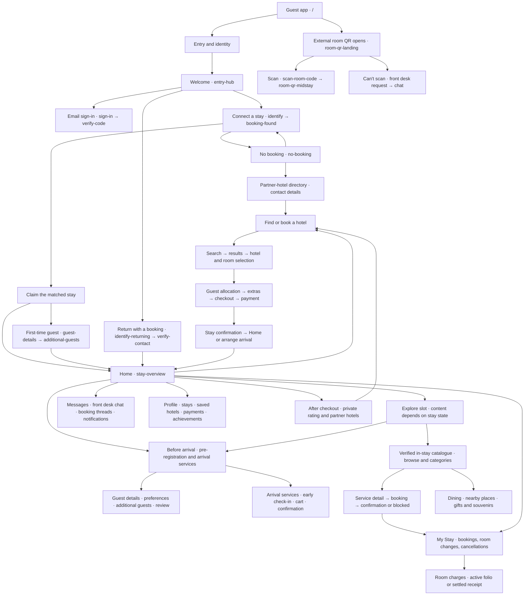

# Cabana guest app: journey map and sitemap for QA

**Audience:** QA, product designers, and developers
**Reviewed:** October 14, 2026
**Scope:** The guest app and the local QA, Storybook, and pilot-reference surfaces in this repository.

This map describes the app as it is implemented now. The main guest experience runs at `/`; its individual screens are client-side states, not separate URL routes. Use the prototype controls or Storybook to start at a specific state. Treat the source files listed at the end as authoritative if the implementation changes.

## Product boundary

Cabana is a stay companion with a separate in-app hotel search and booking journey. A guest can connect an existing stay, prepare for arrival, verify their room, arrange services, review room charges (the active room folio, settled at checkout), contact the front desk, and manage their account. A signed-in guest without a connected stay can also search and book a hotel.

The guest app is a local prototype. Authentication, email codes, booking lookup, hotel inventory, service availability, payment, QR validation, and hotel-system events use fixtures or local simulation. The prototype does not connect to a live identity provider, property-management system (PMS), payment gateway, or vendor system. The guest app does not check guests in, assign rooms, or check guests out; those outcomes come from the hotel and are represented by fixture states or simulated events.

## Sitemap

### Primary navigation

| Guest state | Navigation shown | Notes |
|---|---|---|
| Welcome, sign-in, lookup, and onboarding | No bottom navigation | Keep the guest focused on connecting or preparing a stay. |
| Signed in with no connected stay | Home, Explore, Profile | Explore opens hotel discovery. This state is different from a failed booking lookup. |
| Guest with a connected stay | Home, Explore, My Stay, Chat, Profile | Explore changes by the stay gate. The app bar also provides notifications and, when eligible, room scanning. |
| New-stay checkout, payment, or voucher selection | No bottom navigation | The guest should not leave a payment flow through a tab. |
| Full-screen chat | No bottom navigation | Chat and booking threads use the full screen. |

The app bar's bell opens Notifications. A connected stay's Profile includes stay history and detail, saved hotels, payments and receipts, room preferences, and Achievements. Achievements contains points, badges, and reward redemption.

### Home variants

| Home variant | When it appears |
|---|---|
| Active | An active booking exists or is selected. |
| Upcoming | One upcoming booking exists and none is active. |
| Multiple upcoming | More than one upcoming booking exists and none is active. |
| Completed | No active or upcoming booking remains, but a completed booking remains attached to the session. |
| Empty | No booking exists. An authenticated guest can start hotel search here. |

Home layout uses booking status. Stay labels and lifecycle gates also consider the stay dates and room-verification state. When a fixture's status and dates differ, note both the Home variant and the displayed gate/status in a report.

## End-to-end guest journey

| Stage | Guest goal and entry point | Screens and actions | Gate and expected result | Recovery and QA attention |
|---|---|---|---|---|
| 1. Enter the app | Open `/` and choose an account or booking entry method. | `entry-hub`; Apple or Google SSO fixture; email `sign-in` → `verify-code`; or booking lookup. | Existing account fixtures can open Home. A guest without a connected stay is directed to lookup. | Email and SSO are simulated. Any six-digit email code passes the local format check. Offline entry actions that require a connection stay blocked. |
| 2. Connect a current stay | Enter the booking reference and last name, then review the match. | `identify` → `booking-found` → claim the stay. | The booking becomes part of the guest session. An unauthenticated first-time guest continues to guest details; an authenticated guest returns to the shared Home. | `no-booking` offers another lookup, returning-guest verification, and hotel contact details. The prototype control can switch between permissive and strict lookup fixtures. |
| 3. Re-enter a past stay | Prove access using a booking or confirmation reference. | `identify-returning` → `verify-contact` → Home. | The app verifies a six-digit code against a masked contact fixture, then restores the whole profile and stay history. | A reference alone is not treated as proof of identity. A missing match or missing in-memory step returns the guest to the reference form. |
| 4. Prepare for arrival | Send guest and stay details to the hotel; optionally arrange arrival. | `guest-details`, `additional-guests`, `repeat-review`, `room-preferences`, `early-check-in`, `pre-arrival-services`, `arrival-cart`, `arrival-cart-confirmation`. | The connected booking remains upcoming. Pre-registration does not assign a room. The guest returns to Home after submission. | Room preferences can also be edited from Profile. If offline, pre-registration shows `prereg-queued`; the hotel has not received the changes until connectivity returns. Arrival choices depend on the selected service and its provider. |
| 5. Arrive and wait for a room | Follow the hotel's check-in and room-assignment progress. | Home (`stay-overview`), `rate-detail`, `arrival-handoff`, Notifications. | Room assignment advances through pending, assigned, and ready. The front desk completes hotel check-in and provides the key. | Verify pending without a room number; assigned with a room number; ready; and properties that do not report readiness. Do not treat app pre-registration as check-in. |
| 6. Verify room presence | Open the room scanner after arrival. | `room-qr-landing` → `scan-room-code` → `room-qr-midstay`; or `I can't scan` → front-desk request → `chat`. | On-property services unlock only for the booking whose active dates, room number, and room verification all match. The desk can grant a pending request. | A guest request must not unlock the room by itself. Verify scan failure, offline behavior, a booking that is not active, and switching between multiple bookings. |
| 7. Discover and book a service | Find an eligible service and reserve it. | `marketplace`, `browse`, `category-listing`, `service-detail` / `vendor-service`, `restaurant-menu`, `nearby-recommendations`, `nearby-establishment`, `gifts-souvenirs`, `service-booking`. | The full on-property catalogue requires a verified active stay. A successful booking is a reservation; it is not necessarily a payment. | Check the category, provider, property, time, price, units or guest count, and cancellation terms. Restaurant menu orders open the front-desk chat; eligible table reservations use the service-booking path. Empty catalogue and one-time booking failure are available fixtures. |
| 8. Manage the stay and charges | Review bookings, contact the hotel, or resolve a service change. | `my-stay`, `stay-entry`, `rate-detail`, `folio`, `room-upgrades`, `room-upgrade-confirmation`, `room-upgrade-success`, `room-transfer-details`, `cancel-before-cutoff`, `cancel-after-cutoff`. | Active charges appear on the folio when they post. A confirmed hotel charge settles with the hotel at checkout. Upgrade requests wait for hotel approval; room transfer requires guest confirmation. | Service cancellation timing is listing-specific. Hotel reservation cancellation can also apply to selected rooms/rate plans and linked extras. Check partial cancellation and refunds when a reservation has multiple rooms. |
| 9. Contact the hotel | Ask a question or follow a request. | `messages`, `chat`, `booking-thread`, Notifications. Quick actions and event cards can create front-desk or vendor requests. | Threads and notifications attach to the relevant booking. The front desk remains the recovery path for blocked or late requests. | Check sending, retry/failure, unread state, and the correct booking context. A post-stay front-desk thread closes after the 24-hour window. |
| 10. Finish the stay | Review the settled stay and leave private feedback. | `my-stay`, `folio` / settled receipt, `stay-review` → `stay-review-sent`, Profile stay history. | Checkout is represented as a hotel event or selected fixture, not a guest check-out action. After checkout, Explore opens partner hotels. Front-desk chat stays available for 24 hours, then closes. | Verify that settled charges match the receipt, a review remains private, and the closed state does not promise desk access. |
| 11. Return to the account | See previous stays, payment receipts, or rewards. | `profile`, `stay-history`, `stay-detail`, `payments`, `payment-detail`, `saved-hotels`, `rewards`, `badge-detail`, `reward-detail`. | Profile content follows the restored guest session. Points and badges reflect the local stay and settlement fixtures. | A sign-out returns to Welcome; a device-only guest can forget the booking on that phone. Session and booking drafts can survive reloads in local storage. |

### Separate journey: find and book a hotel

This is a hotel reservation flow, not the service-booking flow. It is available to signed-in guests without a connected stay and from the partner-hotel directory after checkout.

| Step | Screens | QA reference |
|---|---|---|
| Search | `book-stay` | Set destination, dates, adults, and each child's age. Search requires a connection. |
| Compare | `book-stay-results` | Check list/map views, sorting, filters, offers, and empty results. |
| Select property and rooms | `book-stay-hotel` | One reservation can contain different room classes and rate plans. Validate guest capacity and room allocation. |
| Add arrival options | `book-stay-addons` | Extras are optional. They are part of the new stay's checkout, not the active folio. |
| Enter guest details and review price | `book-stay-checkout` | Validate guest-to-room assignment, taxes, fees, totals, and any applied promotion. |
| Pay | `book-stay-vouchers` / `book-stay-payment` | The room reservation is paid now through the local gateway fixture. Payment pages hide bottom navigation. |
| Confirm | `book-stay-confirmation` | Verify the new stay appears in Home and that the guest can continue to the stay or arrange arrival. |

## Lifecycle gates and product rules

The app has four lifecycle gates. The signed-in/no-booking state below is an account state, not a fifth lifecycle gate.

| Gate or state | Opens when | Available surfaces | Must remain gated |
|---|---|---|---|
| Entry | The guest opens the app without a connected stay. | Sign-in, booking lookup, returning-guest verification, and help. | A failed lookup does not connect a booking. |
| Account-only | The guest is authenticated and has no current booking. | Home, Explore hotel search, Profile. | Stay-specific services, My Stay, and Chat have no connected booking context. |
| Pre-arrival | The guest has a connected upcoming booking. | Stay details, pre-registration, early check-in request, and arrival services such as transfers, private car, luggage, and celebration setup. | Room number and verified in-stay services are not available just because the booking dates are near. |
| Arrived, not verified | The stay dates are active, but room verification is absent or the room is not assigned. | Home, support, and the room-verification path. Explore may show a locked in-stay catalogue. | On-property booking, room charging, and other actions that require `canUseOnPropertyServices`. |
| In-stay | The stay window is open, a room is assigned, and that booking has a scan or front-desk verification. | Full on-property Explore, eligible service booking, My Stay, folio, and room changes. | A verified state on one booking must not unlock another booking. |
| Post-stay | The hotel has checked the guest out. | Settled receipt, private review, Profile history, and partner hotels. The front desk remains available for 24 hours after checkout. | After the window closes, do not offer the front-desk chat as available. |

### Provider classes and payment behavior

The guest-facing category (such as Spa & Wellness) and the provider class are separate dimensions. The current `operator` values on service listings are Hotel operated, Hotel arranged, Third-party on property, Curated guide, and Partner on property. Nearby independents and partner hotels are adjacent supply types, not service `operator` values. The main Explore categories are Food & Drinks, Spa & Wellness, Entertainment & Tours, Rentals, and Hotel Services. Gifts & Souvenirs is a separate surface.

| Listing provider or supply type | Common journey | Payment behavior to verify |
|---|---|---|
| Hotel operated | Hotel services and some dining or activities. | For a verified in-stay service booking, a paid item goes to the room folio and settles at checkout. Complimentary items have no charge. |
| Hotel arranged | Arrival transport and other arrangements made by the hotel. | For a verified in-stay service booking, use the room-charge path; it does not offer the third-party pay-now choice. Pre-arrival transport follows the arrival-cart rule below. |
| Third-party on property | Spa, tours, rentals, and other on-property partners. | Eligible paid bookings can offer room charge or pay now. Pay-now uses the gateway fixture and stays separate from the folio. |
| Curated guide | A guide or service selected by the hotel. | Eligible paid bookings can offer room charge or pay now, following the same separation from the folio. |
| Partner on property | For example, independent dining venues with a table-reservation flow. | Follow the listing's own terms; a free table reservation is not a paid service booking. |
| Nearby independent | A directory/recommendation detail outside the hotel's own catalogue. | Check the specific request or reservation behavior. Do not treat it as a hotel-operated service. |
| Partner hotel | A property booked through Cabana. | Pay now as part of the hotel reservation; no folio exists yet for that future stay. |

Service cancellation cutoffs come from the selected listing. The fixture data includes timed cutoffs and non-timed terms such as same-day service or walk-in. A QA run should check the actual listing and booked slot instead of assuming a single cutoff for every provider.

Settlement also depends on the journey stage:

- **Verified in-stay catalogue:** Hotel-operated and hotel-arranged paid services charge the room. Eligible third-party and curated-guide bookings can offer room charge or pay now.
- **Pre-arrival cart:** Paid arrival services, including transport, use one gateway payment. Early check-in is the exception: the hotel must approve it, then the fee goes on the room bill. Complimentary items do not add a payment.
- **New hotel reservation:** The room and selected arrival add-ons are paid with the reservation through the gateway. They do not use a folio for a stay that has not begun.

### Service booking states

The pilot engine can hold a service request for a vendor or the front desk instead of confirming it immediately. Check the booking card and My Stay status before treating a request as a completed booking.

| State | Guest meaning and expected payment behavior |
|---|---|
| `requested` | Waiting for the vendor. It is not yet confirmed. |
| `needs-approval` | Waiting for the front desk to approve a room charge. |
| `pay-or-cancel` | The room-charge request was not approved; the guest can pay in full or cancel. |
| `awaiting-payment` | Payment is required. If the guest sent a request with a payment hold, the amount is taken only if the vendor accepts; an unpaid slot can expire. |
| `confirmed` / `reserved` | The vendor accepted or the table reservation is set. Check whether payment went to the room, gateway, or venue. |
| `declined`, `lapsed`, `withdrawn`, `cancelled`, `payment-expired` | The service is not booked. The guest should not see a completed charge; payment holds are released when the request does not proceed. |

After a vendor commits, the guest can open that vendor's booking thread. Hotel-operated outlets use the front-desk conversation. These states are also documented on `/cases` and in Storybook's Booking lifecycle pattern set.

## QA starting points and state controls

Open the wrench-shaped Prototype controls on `/` to select a starting state, advance hotel/desk events, move the prototype clock, and force conditions. The available stay presets are:

| State or preset | What it represents |
|---|---|
| Signed out | Welcome screen, no connected stay. |
| Signed in, no booking | Account Home and hotel search without a current stay. |
| Pre-arrival | Upcoming booking with arrival tasks. |
| Arrived, not scanned | Active stay with room, before room verification. |
| Live stay | Active, verified stay with room-charge access. |
| Checkout day | Final active-stay day. |
| Just checked out | Settled stay inside the 24-hour front-desk window. |
| Closed | Derived after the post-stay window expires; it is not a separate preset. Use the post-stay control to simulate 24 hours after checkout or reopen the window. |

The controls can also simulate room assignment, a free upgrade, room readiness, an approved upgrade, room verification, history, and review state. The guest-facing `I can't scan` action files the front-desk unlock request. Condition toggles include offline mode, a hotel-system outage, an empty catalogue, and one-time failures for a booking, chat message, or room scan. Some controls represent events from the hotel or pilot engine; they are not guest actions. Use `Reset saved session` to reset the guest session. Use `Clear device data` when a test also needs to remove saved hotels, searches, offers, or a partial hotel-booking draft.

### Storybook references

Run `npm run storybook` and open `http://localhost:6006`. The Guest app page set keeps the app shell and screens in context. Use the story IDs below to open a focused fixture:

| Story | Story ID |
|---|---|
| All screens · choose a page | [`screen-catalog`](http://localhost:6006/?path=/story/cabana-pages-guest-app--screen-catalog) |
| Entry · booking lookup | [`booking-lookup`](http://localhost:6006/?path=/story/cabana-pages-guest-app--booking-lookup) |
| Stay · before arrival | [`stay-before-arrival`](http://localhost:6006/?path=/story/cabana-pages-guest-app--stay-before-arrival) |
| Stay · during the visit | [`stay-during-visit`](http://localhost:6006/?path=/story/cabana-pages-guest-app--stay-during-visit) |
| Services · explore and browse | [`explore-services`](http://localhost:6006/?path=/story/cabana-pages-guest-app--explore-services) |
| Services · booking details | [`service-reservation`](http://localhost:6006/?path=/story/cabana-pages-guest-app--service-reservation) |
| Folio · room charges | [`room-charges`](http://localhost:6006/?path=/story/cabana-pages-guest-app--room-charges) |
| Messages · front desk | [`front-desk-chat`](http://localhost:6006/?path=/story/cabana-pages-guest-app--front-desk-chat) |
| Account · guest profile | [`guest-profile`](http://localhost:6006/?path=/story/cabana-pages-guest-app--guest-profile) |
| Checkout · stay review | [`checkout-review`](http://localhost:6006/?path=/story/cabana-pages-guest-app--checkout-review) |

The Booking lifecycle pattern set covers a booking card, pending payment, and desk approval. The Design system gallery covers shared components. Storybook documents curated page fixtures; it does not connect to live hotel, vendor, or payment systems, and the Storybook MCP is a catalog/documentation tool rather than an end-to-end test result.

## Other application and QA surfaces

These routes are useful to QA but are not guest tabs.

| Route or surface | Purpose | Scope note |
|---|---|---|
| `/cases` | Pilot reference for requests, bookings, payments, chat states, scenarios, and invariants. | This is a pilot simulation/reference page. Use the guest app to verify rendered guest behavior. |
| `/states` | Component and state workbench with URL-selected fixtures and an iframe preview. | A curated component catalog, not an automatic repository scanner. `/states/preview` renders its preview frame. |
| `/components` | Original design-system component gallery. | Component reference, not a guest journey. |
| `http://localhost:6006` | Storybook page sets, lifecycle patterns, and design-system stories. | Separate Storybook server; see `docs/storybook.md` for setup. |
| `/dashboard` | Generic users API starter page. | Not part of the Cabana guest product. |
| `/api/users` and `/api/users/[id]` | Generic users API routes used by the starter dashboard. | Not hotel, booking, vendor, or payment APIs. |
| `/not-found` | App-wide unknown-route page. | Generic fallback with a return-to-home action. |

## Screen index by guest surface

Use these internal IDs when reporting a reproduction. They are states inside `/`, not direct browser paths.

- **Entry and access:** `entry-hub`, `sign-in`, `verify-code`, `identify`, `booking-found`, `identify-returning`, `verify-contact`, `no-booking`, `front-desk-assist`, `room-qr-landing`, `scan-room-code`.
- **Home and pre-arrival:** `stay-overview`, `guest-details`, `room-preferences`, `additional-guests`, `repeat-review`, `rate-detail`, `early-check-in`, `arrival-handoff`, `prereg-complete`, `prereg-queued`, `pre-arrival-services`, `transfer-booking`, `arrival-cart`, `arrival-cart-confirmation`.
- **Hotel search and booking:** `partner-hotels`, `book-stay`, `book-stay-results`, `book-stay-hotel`, `book-stay-addons`, `book-stay-checkout`, `book-stay-payment`, `book-stay-vouchers`, `book-stay-confirmation`.
- **Explore and services:** `marketplace`, `browse`, `category-listing`, `service-detail`, `vendor-service`, `restaurant-menu`, `nearby-recommendations`, `nearby-establishment`, `gifts-souvenirs`, `service-booking`, `booking-confirmation`, `booking-blocked`.
- **My Stay and folio:** `my-stay`, `stay-entry`, `folio`, `room-upgrades`, `room-upgrade-confirmation`, `room-upgrade-success`, `room-transfer-details`, `cancel-before-cutoff`, `cancel-after-cutoff`, `room-qr-midstay`.
- **Messages and notifications:** `messages`, `chat`, `booking-thread`, `notifications`.
- **Profile and post-stay:** `profile`, `stay-history`, `stay-detail`, `saved-hotels`, `payments`, `payment-detail`, `rewards`, `badge-detail`, `reward-detail`, `stay-review`, `stay-review-sent`.

## Source files

- Guest screens and navigation: [guest-app-prototype.tsx](../../src/components/features/guest-app/guest-app-prototype.tsx)
- Lifecycle gates, stay states, services, payment rules, and fixtures: [prototype-model.ts](../../src/components/features/guest-app/prototype-model.ts)
- Hotel search and booking: [stay-booking](../../src/components/features/guest-app/stay-booking/)
- Prototype controls: [prototype-controls.tsx](../../src/components/features/guest-app/prototype-controls.tsx)
- Session and booking-draft persistence: [session-storage.ts](../../src/components/features/guest-app/session-storage.ts)
- Storybook page sets: [page-sets.stories.tsx](../../src/stories/guest-app/page-sets.stories.tsx)
- Pilot reference route: [cases](../../src/components/features/cases/)
- Storybook setup and MCP notes: [docs/storybook.md](../storybook.md)
